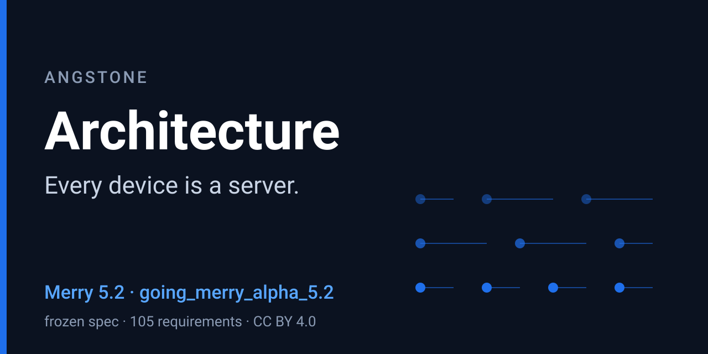
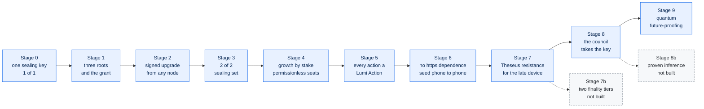
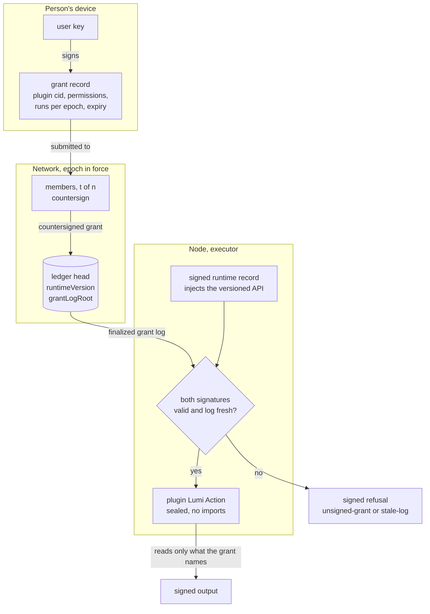
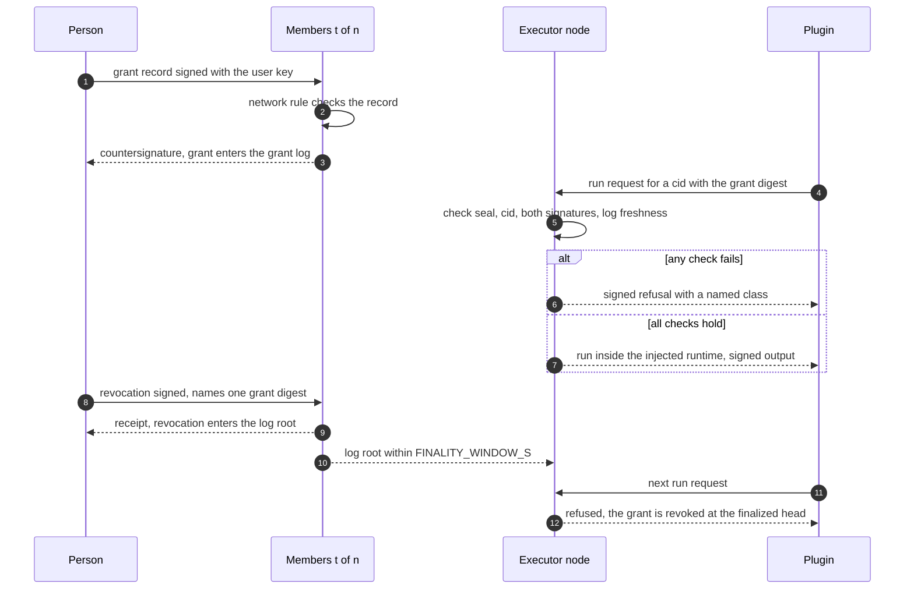
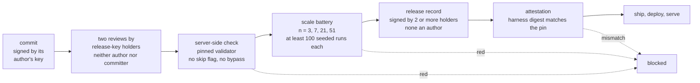

<p align="left">
  
</p>

# Angstone architecture

[](https://github.com/angstone/architecture/releases/tag/going_merry_alpha_5.2.1)
[](LICENSE)
[](docs/spec/README.md)
[](docs/spec/README.md)
[](https://github.com/angstone/architecture/actions/workflows/spec-checks.yml)
[](CONTRIBUTING.md)

**Angstone is a network where every device is a server.** There is no central operator to trust: a set of nodes that grows by stake seals one ledger by threshold signatures, every action a person takes is a sealed, versioned *Lumi Action* that runs the same rule set on every node, and no plugin reads a person's data without that person's signed, revocable grant. This repository is the architecture of Angstone: the normative specification, the reasoning behind it, the decisions with their alternatives, and the tests each rule is held to. It is architecture, not code: where a mechanism is built the text names the commit, where it is design only the text says so. Project site: <https://angstone.app>.

## The trust ladder

The path from one founding key to a council of AIs and a quantum-safe signature is ten stages. Each stage hands authority to a wider set, and each gate is a test, not a promise. Dashed stages are specified but not built.



## Node, runtime, plugin, grant

A plugin is code written by someone else. It never touches a person's data directly: the runtime that the network itself signed injects a versioned API, and every read passes through a grant the person signed and the network countersigned.



## Admission and revocation

Admission is default-deny: a node refuses an action it cannot prove sealed, a plugin it cannot match to a catalog entry and a run without a valid grant. Revocation names exactly one grant, is signed by the person and reaches every node of the epoch within a bounded window.



## The release gate

Nothing ships on trust in a person or a tool. The gate that decides is pinned by digest outside the tree under test, a commit needs reviewers who did not write it, and the scale battery runs the byzantine shapes before a record is signed (rules R4.1 to R4.15).



## How to read the spec

| you want | read | it is | it creates a requirement |
| --- | --- | --- | --- |
| what MUST hold | [`docs/spec/`](docs/spec/README.md) | the normative text, one rule per `R<section>.<n>`, each with its `Test:` and `Enforced at:` | yes |
| why a rule is the way it is | [`docs/rationale/`](docs/rationale) | one `E-R<section>.<n>.md` per rule that has a rationale | no |
| what was chosen over what | [`docs/decisions/`](docs/decisions) | numbered decision records with their alternatives | no |
| how a rule is proven | the `Test:` line of the rule | the test file and the cases that must refuse | the rule's own |
| what changed between versions | [`CHANGELOG.md`](CHANGELOG.md) | the diff in words | no |

Start with [`docs/spec/00-overview.md`](docs/spec/00-overview.md), then the stage you care about (`11-stage-00.md` to `22-stage-09.md`). Part R is `02-runtime.md` to `06-guidelines.md`.

## Attack and conformance tests

Each rule names the test that holds it in its `Test:` line. The tests live in the code repository of the project, which is **private: the links below are visible only to collaborators** (anyone else gets a 404). They are pinned to commit [`b5956b0`](https://github.com/angstone/angstone-network/commit/b5956b089faf9bd74a717da0191e6b33ef1b4fd6) of `angstone/angstone-network`. A test file a rule names that is not in that commit yet is a test still to be written: the rule is specified, the test is owed.

| spec part | scope | tests in the private repository (collaborators only) |
| --- | --- | --- |
| [`docs/spec/02-runtime.md`](docs/spec/02-runtime.md) | R1 Sealed Lumi Actions and the runtime | [`test/lumi.caps.test.ts`](https://github.com/angstone/angstone-network/blob/b5956b089faf9bd74a717da0191e6b33ef1b4fd6/test/lumi.caps.test.ts)<br>[`test/lumi.cid.test.ts`](https://github.com/angstone/angstone-network/blob/b5956b089faf9bd74a717da0191e6b33ef1b4fd6/test/lumi.cid.test.ts)<br>[`test/lumi.domain.test.ts`](https://github.com/angstone/angstone-network/blob/b5956b089faf9bd74a717da0191e6b33ef1b4fd6/test/lumi.domain.test.ts)<br>[`test/lumi.official-range.test.ts`](https://github.com/angstone/angstone-network/blob/b5956b089faf9bd74a717da0191e6b33ef1b4fd6/test/lumi.official-range.test.ts)<br>[`test/lumi.runtime-cid.test.ts`](https://github.com/angstone/angstone-network/blob/b5956b089faf9bd74a717da0191e6b33ef1b4fd6/test/lumi.runtime-cid.test.ts)<br>[`test/lumi.runtime-sign.test.ts`](https://github.com/angstone/angstone-network/blob/b5956b089faf9bd74a717da0191e6b33ef1b4fd6/test/lumi.runtime-sign.test.ts)<br>[`test/lumi.runtime-stale.test.ts`](https://github.com/angstone/angstone-network/blob/b5956b089faf9bd74a717da0191e6b33ef1b4fd6/test/lumi.runtime-stale.test.ts)<br>[`test/lumi.runtime-upgrade.test.ts`](https://github.com/angstone/angstone-network/blob/b5956b089faf9bd74a717da0191e6b33ef1b4fd6/test/lumi.runtime-upgrade.test.ts)<br>[`test/lumi.seal.forms.test.ts`](https://github.com/angstone/angstone-network/blob/b5956b089faf9bd74a717da0191e6b33ef1b4fd6/test/lumi.seal.forms.test.ts)<br>[`test/lumi.seal.inside.test.ts`](https://github.com/angstone/angstone-network/blob/b5956b089faf9bd74a717da0191e6b33ef1b4fd6/test/lumi.seal.inside.test.ts)<br>[`test/lumi.seal.unit.test.ts`](https://github.com/angstone/angstone-network/blob/b5956b089faf9bd74a717da0191e6b33ef1b4fd6/test/lumi.seal.unit.test.ts)<br>[`test/lumi.surface.test.ts`](https://github.com/angstone/angstone-network/blob/b5956b089faf9bd74a717da0191e6b33ef1b4fd6/test/lumi.surface.test.ts) |
| [`docs/spec/03-executor.md`](docs/spec/03-executor.md) | R2 Executor protections | [`test/lumi.limits-order.test.ts`](https://github.com/angstone/angstone-network/blob/b5956b089faf9bd74a717da0191e6b33ef1b4fd6/test/lumi.limits-order.test.ts)<br>[`test/lumi.limits-record.test.ts`](https://github.com/angstone/angstone-network/blob/b5956b089faf9bd74a717da0191e6b33ef1b4fd6/test/lumi.limits-record.test.ts)<br>[`test/lumi.load-verify.test.ts`](https://github.com/angstone/angstone-network/blob/b5956b089faf9bd74a717da0191e6b33ef1b4fd6/test/lumi.load-verify.test.ts)<br>[`test/lumi.metering-constants.test.ts`](https://github.com/angstone/angstone-network/blob/b5956b089faf9bd74a717da0191e6b33ef1b4fd6/test/lumi.metering-constants.test.ts) |
| [`docs/spec/04-plugins.md`](docs/spec/04-plugins.md) | R3 Plugin actions and permissions | [`test/lumi.official-limited.test.ts`](https://github.com/angstone/angstone-network/blob/b5956b089faf9bd74a717da0191e6b33ef1b4fd6/test/lumi.official-limited.test.ts)<br>[`test/lumi.official-list.test.ts`](https://github.com/angstone/angstone-network/blob/b5956b089faf9bd74a717da0191e6b33ef1b4fd6/test/lumi.official-list.test.ts) |
| [`docs/spec/06-guidelines.md`](docs/spec/06-guidelines.md) | R5 Code guideline gate | [`test/guidelines/compile.test.ts`](https://github.com/angstone/angstone-network/blob/b5956b089faf9bd74a717da0191e6b33ef1b4fd6/test/guidelines/compile.test.ts)<br>[`test/guidelines/constants.test.ts`](https://github.com/angstone/angstone-network/blob/b5956b089faf9bd74a717da0191e6b33ef1b4fd6/test/guidelines/constants.test.ts)<br>[`test/guidelines/drawers.test.ts`](https://github.com/angstone/angstone-network/blob/b5956b089faf9bd74a717da0191e6b33ef1b4fd6/test/guidelines/drawers.test.ts)<br>[`test/guidelines/exit.test.ts`](https://github.com/angstone/angstone-network/blob/b5956b089faf9bd74a717da0191e6b33ef1b4fd6/test/guidelines/exit.test.ts)<br>[`test/guidelines/gates.test.ts`](https://github.com/angstone/angstone-network/blob/b5956b089faf9bd74a717da0191e6b33ef1b4fd6/test/guidelines/gates.test.ts)<br>[`test/guidelines/imports.test.ts`](https://github.com/angstone/angstone-network/blob/b5956b089faf9bd74a717da0191e6b33ef1b4fd6/test/guidelines/imports.test.ts)<br>[`test/guidelines/interfaces.test.ts`](https://github.com/angstone/angstone-network/blob/b5956b089faf9bd74a717da0191e6b33ef1b4fd6/test/guidelines/interfaces.test.ts)<br>[`test/guidelines/lint.test.ts`](https://github.com/angstone/angstone-network/blob/b5956b089faf9bd74a717da0191e6b33ef1b4fd6/test/guidelines/lint.test.ts)<br>[`test/guidelines/python.test.ts`](https://github.com/angstone/angstone-network/blob/b5956b089faf9bd74a717da0191e6b33ef1b4fd6/test/guidelines/python.test.ts)<br>[`test/guidelines/scope.test.ts`](https://github.com/angstone/angstone-network/blob/b5956b089faf9bd74a717da0191e6b33ef1b4fd6/test/guidelines/scope.test.ts)<br>[`test/guidelines/seal.test.ts`](https://github.com/angstone/angstone-network/blob/b5956b089faf9bd74a717da0191e6b33ef1b4fd6/test/guidelines/seal.test.ts)<br>[`test/guidelines/type-surface.test.ts`](https://github.com/angstone/angstone-network/blob/b5956b089faf9bd74a717da0191e6b33ef1b4fd6/test/guidelines/type-surface.test.ts)<br>[`test/lumi.caps.test.ts`](https://github.com/angstone/angstone-network/blob/b5956b089faf9bd74a717da0191e6b33ef1b4fd6/test/lumi.caps.test.ts)<br>[`test/lumi.cid.test.ts`](https://github.com/angstone/angstone-network/blob/b5956b089faf9bd74a717da0191e6b33ef1b4fd6/test/lumi.cid.test.ts)<br>[`test/lumi.domain.test.ts`](https://github.com/angstone/angstone-network/blob/b5956b089faf9bd74a717da0191e6b33ef1b4fd6/test/lumi.domain.test.ts)<br>[`test/lumi.limits-order.test.ts`](https://github.com/angstone/angstone-network/blob/b5956b089faf9bd74a717da0191e6b33ef1b4fd6/test/lumi.limits-order.test.ts)<br>[`test/lumi.limits-record.test.ts`](https://github.com/angstone/angstone-network/blob/b5956b089faf9bd74a717da0191e6b33ef1b4fd6/test/lumi.limits-record.test.ts)<br>[`test/lumi.load-verify.test.ts`](https://github.com/angstone/angstone-network/blob/b5956b089faf9bd74a717da0191e6b33ef1b4fd6/test/lumi.load-verify.test.ts)<br>[`test/lumi.metering-constants.test.ts`](https://github.com/angstone/angstone-network/blob/b5956b089faf9bd74a717da0191e6b33ef1b4fd6/test/lumi.metering-constants.test.ts)<br>[`test/lumi.official-limited.test.ts`](https://github.com/angstone/angstone-network/blob/b5956b089faf9bd74a717da0191e6b33ef1b4fd6/test/lumi.official-limited.test.ts)<br>[`test/lumi.official-list.test.ts`](https://github.com/angstone/angstone-network/blob/b5956b089faf9bd74a717da0191e6b33ef1b4fd6/test/lumi.official-list.test.ts)<br>[`test/lumi.official-range.test.ts`](https://github.com/angstone/angstone-network/blob/b5956b089faf9bd74a717da0191e6b33ef1b4fd6/test/lumi.official-range.test.ts)<br>[`test/lumi.runtime-cid.test.ts`](https://github.com/angstone/angstone-network/blob/b5956b089faf9bd74a717da0191e6b33ef1b4fd6/test/lumi.runtime-cid.test.ts)<br>[`test/lumi.runtime-sign.test.ts`](https://github.com/angstone/angstone-network/blob/b5956b089faf9bd74a717da0191e6b33ef1b4fd6/test/lumi.runtime-sign.test.ts)<br>[`test/lumi.runtime-stale.test.ts`](https://github.com/angstone/angstone-network/blob/b5956b089faf9bd74a717da0191e6b33ef1b4fd6/test/lumi.runtime-stale.test.ts)<br>[`test/lumi.runtime-upgrade.test.ts`](https://github.com/angstone/angstone-network/blob/b5956b089faf9bd74a717da0191e6b33ef1b4fd6/test/lumi.runtime-upgrade.test.ts)<br>[`test/lumi.seal.forms.test.ts`](https://github.com/angstone/angstone-network/blob/b5956b089faf9bd74a717da0191e6b33ef1b4fd6/test/lumi.seal.forms.test.ts)<br>[`test/lumi.seal.inside.test.ts`](https://github.com/angstone/angstone-network/blob/b5956b089faf9bd74a717da0191e6b33ef1b4fd6/test/lumi.seal.inside.test.ts)<br>[`test/lumi.seal.unit.test.ts`](https://github.com/angstone/angstone-network/blob/b5956b089faf9bd74a717da0191e6b33ef1b4fd6/test/lumi.seal.unit.test.ts)<br>[`test/lumi.surface.test.ts`](https://github.com/angstone/angstone-network/blob/b5956b089faf9bd74a717da0191e6b33ef1b4fd6/test/lumi.surface.test.ts) |

## Versions

| version | tag | status |
| --- | --- | --- |
| Merry 5.2.1 | `going_merry_alpha_5.2.1` | frozen, in force (erratum of 5.2: the release token only, no requirement changed) |
| Merry 5.2 | `going_merry_alpha_5.2` | frozen, superseded by 5.2.1 |
| Merry 5.1 | `going_merry_alpha_5.1` | frozen, superseded by 5.2 |
| Merry 5 | `going_merry_alpha_5` | frozen, superseded |
| Merry 2 | `going_merry_alpha_2` | frozen, superseded |
| alpha 1 | `architecture-alpha-1` | frozen, superseded |

Only Merry 5.2.1 and its tag are published here (the tag of 5.2 is kept, never moved); earlier versions live in the project's private history and their texts are not part of this repository. A tag is never moved.

## How to contribute

Humans and AIs are welcome. Every change is a pull request; the owner reviews and merges. Read [CONTRIBUTING.md](CONTRIBUTING.md) first: a change to `docs/spec` cites the R-id it touches, adds or changes that rule's test reference and passes the checks, and a pull request written by an AI says so. Found a defect or an ambiguity? Open an [issue](https://github.com/angstone/architecture/issues/new/choose). A vulnerability goes through a private advisory, see [SECURITY.md](SECURITY.md). Conduct: [Contributor Covenant 2.1](CODE_OF_CONDUCT.md).

The text at the tag is frozen: a proposal that changes a requirement is a proposal for the next version, and is merged on `main` as such, never by editing history or moving the tag.

## How to verify

```sh
git clone https://github.com/angstone/architecture && cd architecture
git rev-parse 'going_merry_alpha_5.2.1^{commit}'     # the commit the tag names
git diff --stat going_merry_alpha_5.2.1 -- docs      # empty: the spec is the tag's text
node scripts/check-spec.mjs                          # 105 R-ids once, rationale pointers, one header
node scripts/check-names.mjs                         # no natural person is named
node scripts/check-links.mjs                         # every relative link resolves
sha256sum -c SHA256SUMS                              # after downloading the release assets next to it
```

- Tag: `going_merry_alpha_5.2.1`. The tag commit is printed by `git rev-parse` above and listed in the [release notes](https://github.com/angstone/architecture/releases/tag/going_merry_alpha_5.2.1).
- The `commit 8157617` in each spec header is the commit of the project's source repository that froze the 5.2 text this version corrects; the tag of this repository names the published commit.
- The release carries the paper, the full specification as one PDF and `SHA256SUMS`.

## Licence and editorial note

Text licensed under [CC BY 4.0](LICENSE). The specification is the frozen text of the version; the only edit made for this publication is that 2 mentions of a natural person's name were replaced by "the owner". Paths in the text (for example `network/`, `site/`, `test/`) refer to the code repositories of the project, not to this one. Cite as in [CITATION.cff](CITATION.cff).
